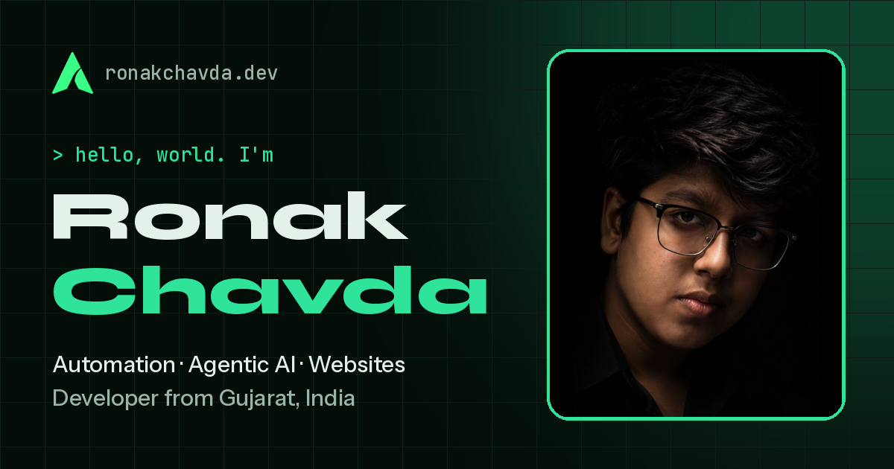

<div align="center">



# Ronak Chavda · Portfolio

**Developer & automation builder.** I build AI agents, automation scripts and websites.

[**ronakchavda.dev**](https://ronakchavda.dev)


</div>

---

## About me

Hey, I'm Ronak, a developer from **Gujarat, India**. I turn slow, repeated work into code that runs on its own: AI agents, automation scripts and websites for people who would rather spend their time on something else.

> Just a programmer who hates doing things *twice.*

Most of my time goes into automation and agentic AI. I also build websites and custom tools for other people. Every project on my GitHub started as a problem I had myself.

### What I do

| | |
| --- | --- |
| 🤖 **Agentic AI** | AI agents that plan the steps, use tools, check their own results and finish real tasks on their own. And an honest answer when plain code is the better choice. |
| ⚡ **Automation** | Scripts and bots for the work you repeat every day: moving files, collecting data from websites, filling forms, clicking through the same screens. |
| 🖥️ **Websites & tools** | Fast, good-looking websites and custom tools for clients, from a simple landing page to a full web app with a backend and a database. |

### Tech stack

- **Languages:** Python, JavaScript, TypeScript, PHP, HTML, CSS
- **Frameworks:** React, Next.js, Node.js, Django, Flask
- **Tools:** Git, GitHub, Docker, Linux, PostgreSQL, VS Code

### Projects

| Project | Type | Status |
| --- | --- | --- |
| [**wherewasi**](https://github.com/RonakChavda-Dev/wherewasi) | Developer tool | ⭐ Featured |
| **Amazon Price Tracker** | Web scraper | ✅ Built |
| **I'm Not a Robot Beater** | Browser automation | 🚧 In progress |

- **wherewasi**: a local-first developer tool that rebuilds your coding context after a break and tells you where to pick up again. No cloud, no account, it works on your own machine.
- **Amazon Price Tracker**: watches product prices on Amazon, so you can buy at the right time without checking by hand.
- **I'm Not a Robot Beater**: a bot that plays and beats "I'm Not a Robot", the browser game by Neal Agarwal (neal.fun), one level at a time.

### How I work

1. **Understand**: we talk through the task, what slows you down, and what "done" looks like.
2. **Plan**: I map the steps, pick the right tools, and decide where AI helps and where plain code is better.
3. **Build & test**: I write the code and test it on real examples until it works every time, not just once.
4. **Hand over**: you get working software, simple notes on how to use it, and help if anything changes.

### Get in touch

- ✉️ **Email:** [ronakchavda.dev@gmail.com](mailto:ronakchavda.dev@gmail.com)
- 𝕏 **X:** [@RonakChavda_Dev](https://x.com/RonakChavda_Dev)
- 💼 **LinkedIn:** [Ronak Chavda](https://www.linkedin.com/in/ronak-chavda-903056416/)
- 📸 **Instagram:** [@ronak_chavda_dev](https://www.instagram.com/ronak_chavda_dev/)
- 🐙 **GitHub:** [RonakChavda-Dev](https://github.com/RonakChavda-Dev)

---

## About this website

A single-page portfolio built with **Next.js (App Router)** and **React**, styled with plain CSS Modules, no UI library.

- 🌗 Light and dark mode that follows your system setting and remembers your choice
- ✨ Scroll animations, a loading screen, moving tool strips and crossing ribbons
- 🔤 Self-hosted fonts (Instrument Sans, Instrument Serif, JetBrains Mono), so nothing loads from outside
- 📝 All the text, links and projects live in one file: [`data/site.js`](data/site.js)
- 📦 Exported as static files (`output: "export"`), so it can be hosted anywhere without a server
- 🔗 Open Graph and Twitter preview card, `robots.txt` and `sitemap.xml`

### Project structure

```
.
├── app/
│   ├── fonts/          # Self-hosted font files
│   ├── globals.css     # Colors, theme tokens and shared styles
│   ├── icon.png        # Browser tab icon
│   ├── layout.js       # Page title, fonts, SEO and preview card settings
│   └── page.js         # The page: puts all the sections in order
├── components/         # One component per section (Hero, About, Projects, ...)
│                       # each with its own .module.css file
├── data/
│   └── site.js         # All the words, links, projects, skills and FAQ
├── public/
│   ├── images/         # Photo and logos
│   ├── og-image.png    # Link preview picture
│   ├── robots.txt
│   └── sitemap.xml
└── next.config.mjs     # Static export settings
```

### Editing the content

- **Text, links, projects, FAQ:** edit [`data/site.js`](data/site.js). Words inside `*stars*` are shown in the slanted serif font.
- **Photo and logos:** replace the files in `public/images/` with new ones that have the same names (`ronak-hero.jpg`, `logo-white.png`, `logo-green.png`).
- **Tab icon:** `app/icon.png`
- **Link preview card:** `public/og-image.png`, with the title and description set in `app/layout.js`

---

## Running it locally

### Prerequisites

- [Node.js](https://nodejs.org) (the LTS version), which comes with npm
- [Git](https://git-scm.com)

### Steps

1. **Clone the repository**

   ```bash
   git clone https://github.com/RonakChavda-Dev/portfolio-website.git
   cd portfolio-website
   ```

2. **Install the dependencies**

   ```bash
   npm install
   ```

3. **Start the development server**

   ```bash
   npm run dev
   ```

4. **Open [http://localhost:3000](http://localhost:3000)** in your browser. The page reloads by itself when you save a file.

Press `Ctrl + C` in the terminal to stop the server.

### Building for production

```bash
npm run build
```

This creates a fully static version of the site in the `out/` folder. You can upload that folder to any static host (this site uses Cloudflare Pages, with build command `npm run build` and output directory `out`).

To preview the built site locally, serve the `out/` folder with any static file server, for example:

```bash
npx serve out
```

---

<div align="center">

Designed and built by **Ronak Chavda** · Gujarat, India

</div>
